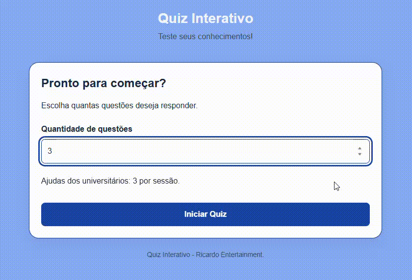

# Quiz Interativo

Aplicativo web educacional desenvolvido com HTML, CSS e JavaScript puro.

## Sobre o projeto

O Quiz Interativo permite estudar diferentes disciplinas por meio de perguntas de múltipla escolha, dicas pedagógicas e revisão dos erros.

O estudante pode selecionar a quantidade de perguntas e responder no próprio ritmo, sem temporizador.

## Demo ao vivo
[Acesse o Weather App](https://github.com/rikrdopires/Projeto-5---QuizInterativo.git)

## Preview

 

## Funcionalidades

- Seleção da quantidade de questões
- Banco de perguntas em JSON
- Sorteio aleatório sem repetição por sessão
- Correção imediata das respostas
- Pontuação e barra de progresso
- Três ajudas dos universitários por sessão
- Revisão dos erros com explicações
- Diagnóstico de desempenho por disciplina
- Recomendações de estudo
- Melhor resultado salvo no navegador
- Layout responsivo

## Tecnologias

- HTML5
- CSS3
- JavaScript
- JSON
- localStorage

## Como executar

1. Clone ou baixe o repositório.
2. Abra a pasta no Visual Studio Code.
3. Execute `index.html`.
4. Escolha a quantidade de questões e inicie o quiz.

O Live Server permite carregar o banco JSON por meio da Fetch API.

## Estrutura

    QuizInterativo/
    │
    ├── index.html 
    ├── style.css 
    ├── script.js 
    ├── questions.json
    ├── README.md 
    └── preview.gif

## O que aprendi

- Organizar uma aplicação JavaScript em constantes, seletores DOM, estados, funções, eventos e inicialização.
- Separar o banco de perguntas, o processamento dos dados e a renderização da interface.
- Carregar arquivos JSON utilizando fetch e async/await.
- Trabalhar com arrays e objetos para estruturar perguntas, alternativas, respostas e explicações.
- Manipular dinamicamente o DOM com createElement, appendChild, textContent e classList.
- Controlar eventos de interação utilizando addEventListener.
- Gerenciar estados da aplicação, como pontuação, progresso, questões respondidas e dicas disponíveis.
- Implementar validações de entrada, correção automática de respostas e feedback visual.
- Embaralhar perguntas com o algoritmo Fisher–Yates, evitando repetições na mesma sessão.
- Processar e filtrar dados utilizando forEach, map, filter e Map.
- Calcular percentuais de acertos e organizar o desempenho por disciplina.
- Gerar dinamicamente painéis de revisão dos erros e recomendações de estudo.
- Persistir a melhor pontuação no navegador utilizando localStorage.
- Implementar tratamento de erros com try/catch e controlar o carregamento inicial da aplicação.
- Aplicar responsividade e acessibilidade com CSS Grid, Flexbox, media queries e :focus-visible.
- Utilizar o DevTools para investigar erros, inspecionar elementos e verificar o carregamento dos arquivos.
- Praticar o desenvolvimento incremental, a organização do código e a publicação de aplicações estáticas com GitHub Pages.

## Próximas melhorias

- Ampliação do banco de perguntas
- Filtros por disciplina e assunto
- Novos recursos de acompanhamento de estudos

## Autor
Desenvolvido por **Ricardo Ribeiro** como parte do meu portfólio de estudos em ADS.